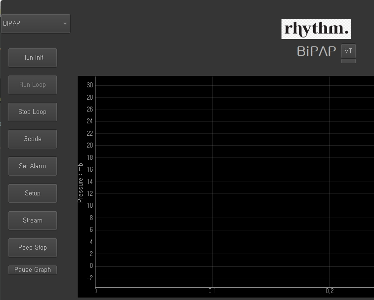

### Demo Streaming class backfeed.py

This backfeed.py class reads a text file and send the data to the main window.
In k2_rythm.py at
```python
    @Slot()
    def on_btnstream_clicked(self):
        self.streamer = Backfeed('log4.txt')
        self.streamer.setCallback(self.getStreamData)
        self.streamer.Start(100)
```

see that ```self.getStreamData``` is registered to the callback, hence ```getStreamData``` eventually calls to ```self.LungSensorData(line)``` which is the main graph displaying and other dicision makin function.

# Enabling Demo for Desktop Simulation

Since k2_rhythm.py is the main file for most of the event handling. VentUI.ui is the 
main UI file. Left side panel is a nested UI, The panel is referenced in the code as 
`self.stackedWidget_2` and can be toggled by `.show` or `.hide` method.

In k2_rhythm.py set the global variable `left_panel_visible = False` to False. The function 
`def show_hide_LeftPanel(self):` is called by constructor during startup. It is a toggling 
function between show and hide of the left panel.

<br>
